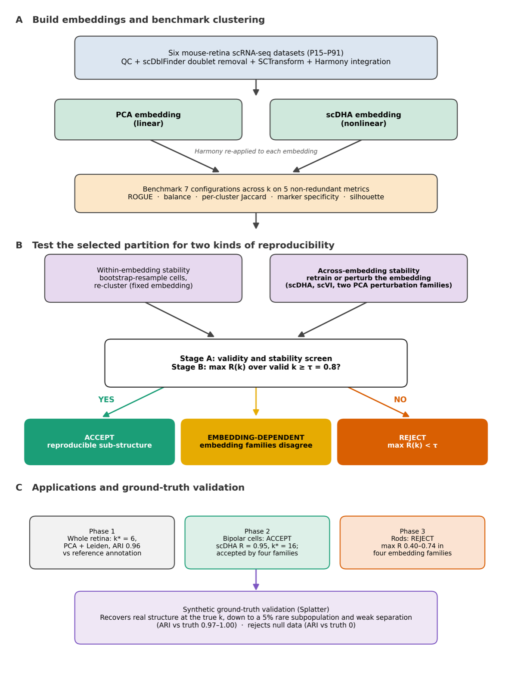

# scClustBench

**scClustBench** is an R pipeline that decides, without cell labels, whether a single-cell
RNA-seq population contains reproducible sub-structure, and if it does, how many clusters to
report and which clustering configuration to use.

It benchmarks clustering configurations (embedding x algorithm x number of clusters k) on five
label-free quality metrics, then applies a two-stage decision rule:

| Stage | Question | Test |
|---|---|---|
| A. Screen | Is this partition valid and stable within one embedding? | reaches its target k; no cluster under 20 cells; minimum bootstrap Jaccard >= 0.6; survivors ranked by mean metric percentile |
| B. Reproduce | Do independently trained or perturbed embeddings find the same partition? | R(k) = mean pairwise ARI across embeddings; **ACCEPT** if max R(k) >= 0.8, else **REJECT**; k\* = the largest k within 0.01 of the maximum |

Running Stage B with several embedding families (scDHA seeds, PCA gene resampling, PCA
hyperparameters, scVI seeds) and comparing their verdicts shows whether a structure is
**EMBEDDING-DEPENDENT**.

This repository contains the tool (`R/`) and the complete analysis behind the paper, run on an
integrated six-sample mouse retina atlas (`pipeline/`):

> Yousef Z, Simone J, Klein D, Cho H, Bhuyan A, Bhatt P, Wu J, Wang H, Cai L.
> *A Label-Free Multi-Metric Pipeline for Benchmarking Single-Cell RNA-Sequencing Clustering
> and Testing the Reproducibility of Cell-Type Heterogeneity.*

<p align="center"></p>

---

## Contents

- [Installation](#installation)
- [Quick start on your own data](#quick-start-on-your-own-data)
- [Reading the result](#reading-the-result)
- [Reproducing the paper](#reproducing-the-paper)
- [Repository layout](#repository-layout)
- [Documentation](#documentation)
- [Citation](#citation)

## Installation

Requirements: R 4.4 or later (the paper used R 4.5).

```r
install.packages(c("Seurat", "igraph", "cluster", "mclust", "harmony", "aricode", "uwot",
                   "dplyr", "tidyr", "ggplot2", "patchwork", "remotes", "BiocManager"))
```

Optional packages add metrics or embeddings. Without them the metric is reported as `NA` or the
embedding is skipped.

| Package | Adds | Install |
|---|---|---|
| ROGUE | the ROGUE purity metric | `remotes::install_github("PaulingLiu/ROGUE")` |
| scDHA + torch | the scDHA embedding (default Stage B family) | `install.packages("torch"); torch::install_torch(); remotes::install_github("duct317/scDHA")` |
| scran | scran normalization | `BiocManager::install("scran")` |
| scvi-tools (Python) | the scVI embedding | `pip install scvi-tools==1.4.2`, then set `RETICULATE_PYTHON` to that Python |

The scripts in `pipeline/` additionally need `scDblFinder`, `splatter` and `scRNAseq`
(Bioconductor). Every ARI and NMI call converts the labels to factors first, so aricode 1.0.3
(the version used for the paper) and 1.1.0 both work. [docs/ENVIRONMENT.md](docs/ENVIRONMENT.md)
lists the exact versions used and how the cluster environments were built.

Check the installation (simulated data, no download needed, about 10 minutes on a laptop):

```bash
Rscript tests/smoke_test.R
```

It should end with `ALL ASSERTIONS PASSED`.

## Quick start on your own data

Input: a Seurat object with **raw counts** in the `RNA` assay, restricted to the population you
want to test (a whole dataset, or one cell type to ask whether it has reproducible subtypes).

```r
source("R/scClustBench.R")                      # run from the repository root
obj <- readRDS("my_cells.rds")
res <- sccb_run(obj, batch = "sample", k_range = 2:10,
                embeddings = "pca",
                methods = c("kmeans", "gmm", "louvain", "leiden"),
                repro_embeddings = "pca_perturb",   # add "scdha" when installed
                out_dir = "sccb_out")

res$recommended   # verdict, k*, and the configuration chosen at k*
res$partition     # cell -> cluster for that configuration (NULL on REJECT)
```

The same from the command line (arguments: input, batch column or `none`, output folder, largest
k, bootstrap resamples):

```bash
Rscript examples/run_on_own_data.R my_cells.rds sample sccb_out 10 20
```

All result tables are written to the output folder as `sccb_*.csv`. See
[docs/USAGE.md](docs/USAGE.md) for every argument, the individual functions, and runtime advice.

## Reading the result

| Field | Meaning |
|---|---|
| `res$recommended` | The answer: ACCEPT or REJECT, k\*, and the top-ranked admissible configuration at k\* |
| `res$partition` | Cell labels for that configuration |
| `res$verdict` | Stage B per embedding family: `k_star`, `k_star_smallest`, `k_star_at_edge`, `max_R` |
| `res$curve` | R(k) for every family and k, with the smallest cluster size across embeddings |
| `res$selection` | Stage A: every partition, whether it is admissible, and its rank score |
| `res$scores` | The five metrics for every partition |

- `k_star_at_edge = TRUE`: k\* is the largest k tested. Extend `k_range` and run again.
- Families disagree: `res$recommended$note` says so. Treat the structure as embedding-dependent.
- A tiny `min_cluster_size` at k\* means R(k) is inflated by a few outlier cells. Do not report
  that k.
- tau = 0.8 is a fixed floor, not a calibrated threshold. On the 20 simulated nulls of
  `pipeline/16`, the 95th percentile of the null maximum R(k), taken over the valid k of the
  final (gated) rule, is 0.76 for scDHA and 0.11 (0.105) for `pca_perturb`
  (`output/tables/17_stageB_gated_calibration.csv`, `12_verdicts.csv`). The tracked
  `16_null_calibration_tau.csv` lists 0.117 for `pca_perturb`, the same percentile without the
  validity gates. Either way the family's null R(k) stays far below 0.8, so tau is never raised
  for `pca_perturb`; run at least two families.

## Reproducing the paper

1. **Data.** Download the six public mouse retina 10x samples from GEO (GSM8133387, GSM8133389,
   GSM7734028, GSM7720305, GSM7720306, GSM6205478). Put each Cell Ranger output folder in one
   directory under the folder names listed in `SAMPLES` in [config.R](config.R), and point
   `SCCB_RAW_DATA` at that directory:

   ```bash
   export SCCB_RAW_DATA=/path/to/retina_samples
   ```

2. **Run.** From the repository root:

   ```bash
   Rscript run_pipeline.R --list      # the steps, in order
   Rscript run_pipeline.R             # everything (several days on one workstation)
   Rscript run_pipeline.R 06 08b      # selected steps only
   Rscript run_pipeline.R --from 07_bc
   ```

   On a Slurm cluster, `bash hpc/slurm/submit_all.sh` submits the same steps as a dependency
   graph so independent steps run in parallel ([docs/HPC.md](docs/HPC.md)).

3. **Outputs.** Paper figures are written to `output/paper/` as `Figure_1` to `Figure_7` and
   `Supplementary_Figure_S1` to `S6` (PNG and PDF). Result tables are in `output/tables/` (rods,
   bipolar cells, controls) and `output_full_dataset/tables/` (whole retina). The tables from the
   paper's run are included in the repository. From them alone, without the multi-day
   computation, the figure steps `fig1`, `08`, `10`, `04d` and `13f` can be rerun (Figures 1, 6
   and 7, Supplementary Figures S3, S4 and S6). Steps `06` (Figures 2, 3 and 5, Supplementary Figures
   S1, S2 and S5) and `08b` (Figure 4) also need untracked files from earlier steps: `06` reads
   `output/rds/02_annotated.rds`, `output/rds/02_rods.rds`,
   `output/tables/03_harmony_scdha_latent.csv` and
   `output_full_dataset/tables/poc_harmony_pca_umap.csv` (computed from
   `poc_harmony_pca_latent.csv` if absent); `08b` reads `output/rds/07_bc_positive_control.rds`.
   [docs/OUTPUTS.md](docs/OUTPUTS.md) maps every figure and table to the step that makes it.

   `output/tables/16_null_calibration_curves.csv` is also the resume checkpoint of step 16, so
   on a fresh clone that step only recomputes its summary tables; run it with `FRESH=1` to
   recompute the simulations.

Random seeds are fixed (`SEED = 1` in `config.R`; Stage B uses seeds 1, 2, 3, 7, 42). scDHA and
scVI training is not bit-for-bit deterministic on every platform, which is one reason the rule
measures agreement across seeds instead of trusting a single run.

## Repository layout

```
.
├── R/                         the scClustBench tool
│   ├── scClustBench.R         embeddings, clustering methods, metrics, sccb_run()
│   ├── decision_rule.R        Stage A (sccb_select) and Stage B (sccb_verdict)
│   └── utils.R                helpers shared by the pipeline scripts
├── config.R                   paths, sample table and every analysis parameter
├── run_pipeline.R             runs the paper analysis, all steps or a subset
├── pipeline/                  one script per analysis step (00 to 17c), in run order
├── data/annotation/           hand annotation of the 34 Harmony clusters (reference labels)
├── examples/                  command-line example for your own data
├── tests/                     smoke test, speed-up equivalence test, comment-only check
├── hpc/slurm/                Slurm scripts (environment setup, one-step jobs, full submission)
├── docs/                      detailed documentation
├── assets/                    images used in this README
└── output/, output_full_dataset/   result tables (large .rds and latent files are not tracked)
```

## Documentation

| Document | Contents |
|---|---|
| [docs/USAGE.md](docs/USAGE.md) | Using the tool on your own data: functions, arguments, runtime |
| [docs/PIPELINE.md](docs/PIPELINE.md) | What each step in `pipeline/` does, its inputs, outputs and options |
| [docs/OUTPUTS.md](docs/OUTPUTS.md) | Which step produces each paper figure and table |
| [docs/EXTENDING.md](docs/EXTENDING.md) | Adding a clustering method or embedding; changing parameters; code conventions |
| [docs/HPC.md](docs/HPC.md) | Running the analysis on a Slurm cluster |
| [docs/ENVIRONMENT.md](docs/ENVIRONMENT.md) | Software versions and environment setup |

## Citation

If you use scClustBench, please cite the paper above. Citation metadata is in
[CITATION.cff](CITATION.cff).

Questions and bug reports: open an issue, or contact Li Cai (lcai@rutgers.edu).

## License

MIT; see [LICENSE](LICENSE).
